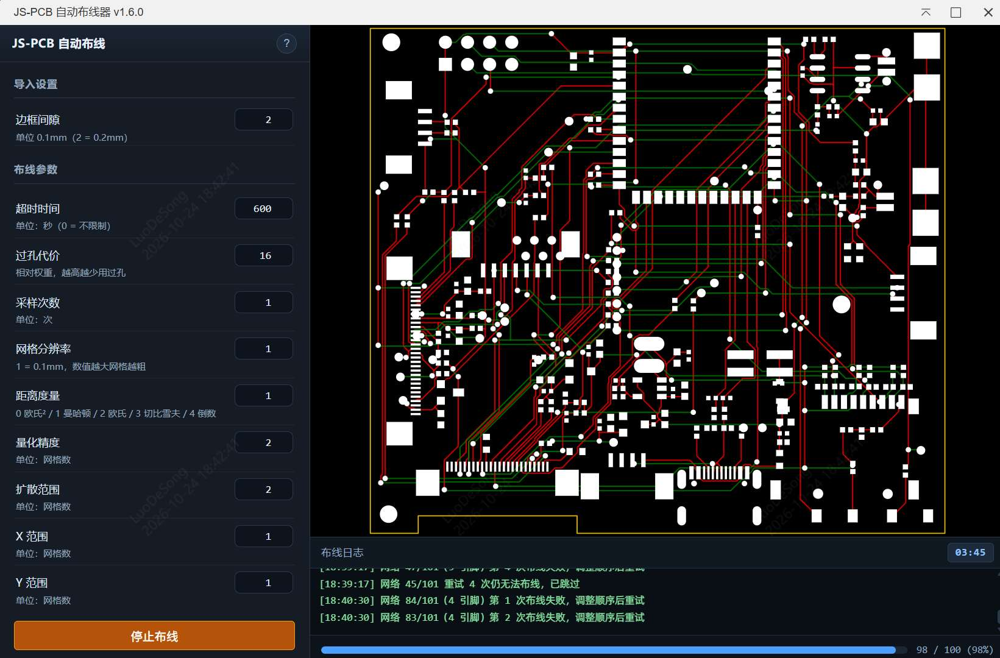

# JS-PCB 自动布线器（嘉立创EDA专业版）

基于开源项目 [JS-PCB](https://github.com/vygr/JS-PCB) 的嘉立创EDA专业版自动布线扩展。



## 功能特性

- **自动载入 DSN**：打开窗口即获取当前 PCB 的 DSN 并显示预览。
- **动态布线预览**：布线过程中实时更新焊盘和走线。
- **焊盘分层显示**：顶层焊盘红色、底层焊盘绿色、通孔焊盘白色，并带图例。
- **板框显示与约束**：绘制真实 DSN 板框（含凹槽），并作为布线障碍。
- **开始 / 停止**：布线中按钮变为“停止布线”，可随时终止并再次开始。
- **自动导入 SES**：布线完成后直接导入当前 PCB，无需手动操作。
- **详细日志**：预览区底部显示带时间戳的工作日志，附进度条和已布通比例。
- **间距控制**：按 DSN 中每个网络的间距布线，并提供全局“额外间距”。
- **板边安全**：走线/过孔与板框保持间距。
- **多语言界面**：自动跟随 EDA 语言；问号左侧按钮可切换中英文。

## 环境要求

- 支持扩展的嘉立创EDA专业版（`engines.eda: ^3.2.0`）。
- 已打开 PCB 文档。

## 安装

```bash
npm install
npm run build
```

在嘉立创EDA专业版中安装打包后的扩展（扩展 → 从文件安装），然后打开 PCB 文档。

## 使用方法

1. 在嘉立创EDA专业版中打开 PCB 文档。
2. 点击 PCB 菜单中的 **JsPCB自动布线**。
3. 窗口会自动获取 DSN，并显示板框和焊盘的静态预览。
4. 按需调整布线参数。
5. 点击 **开始布线**，按钮会变为 **停止布线**。
6. 布线完成或达到超时后，SES 结果会自动导入当前 PCB。

## 参数说明

| 参数       | 单位 / 范围                | 说明                                                           |
| ---------- | -------------------------- | -------------------------------------------------------------- |
| 超时时间   | 秒，0–10000，默认 **3600** | 每次采样的最大运行时间，`0` 表示不限制；超时保留当前最佳结果。 |
| 边框间隙   | 0.1 mm，1–5，默认 2        | 板框与布线网格之间的边距，**不是**电气间距。                   |
| 额外间距   | 0.1 mm，0–20，默认 0       | 在 DSN 每个网络的间距基础上统一增加，用于进一步消除 DRC。      |
| 过孔代价   | 相对权重，0–256，默认 16   | 数值越高，布线越少使用过孔。                                   |
| 采样次数   | 次，1–32，默认 1           | 尝试布线的次数，取最佳结果。                                   |
| 网格分辨率 | 1–4，默认 1                | `1` = 0.1 mm 网格，数值越大网格越粗。                          |
| 距离度量   | 0–4，默认 1                | 0 欧氏²、1 曼哈顿、2 欧氏、3 切比雪夫、4 倒数。                |
| 量化精度   | 网格数，0–64，默认 2       | 布线启发式使用的坐标量化等级。                                 |
| 扩散范围   | 网格数，0–5，默认 2        | 洪水填充的搜索范围。                                           |
| X / Y 范围 | 网格数，0–5，默认 1        | 按层区分的水平/垂直搜索范围。                                  |

## 间距（Clearance）说明

- 电气间距来自 **DSN**，不是单一全局值：
    - 每个网络使用其 class 中的 `clearance`；
    - 没有 class 时使用 structure 中的默认 `(rule (clear ...))`；
    - padstack 继承默认规则。
- **边框间隙** 是板框外的布线网格边距，不是铜皮间距。
- 已修复原代码把 clearance 除以 2 的 bug；现在使用 DSN 的完整间距。
- **额外间距** 会在 DSN 间距基础上，对走线、焊盘和过孔统一增加。
- 板框会作为所有层的墙壁参与碰撞，走线/过孔与板边保持间距。

注意：间距越严格，布通率越低。如果 PCB 本身的焊盘间距就小于其规则，
产生的 DRC 属于布局问题，布线器无法修复。

## 已知限制

- JS-PCB 引擎较简单，高密度或复杂板可能布通率较低。
- 某个网络连续 4 次仍无法布通时会被跳过，以便其余网络完成；结束吐司/日志会报告已布通和未布通数量。
- 部分 DRC 可能来自 PCB 布局本身（例如焊盘间距不足），或 EDA 中未包含在 DSN 里的规则。

## 许可证

本项目以 **GNU General Public License v2.0 (GPL-2.0)** 分发。
完整条款见 [LICENSE](LICENSE)。

## 第三方组件

- **JS-PCB**（https://github.com/vygr/JS-PCB）— GPL-2.0
    - 核心布线文件：`iframe/jspcb/router.js`、`worker.js`、`mymath.js`、`layer.js`。
    - `iframe/jspcb/main.js`：嘉立创EDA API 集成（DSN 获取、SES 导入）与界面胶水代码。
    - `iframe/jspcb/dsn-normalizer.js`：归一化 EasyEDA DSN 的坐标、单位和层名。
    - `iframe/jspcb/index.html`：适配 EDA 扩展风格的界面。
    - 修复了 iframe/跨域环境下的 Worker 加载问题。

## 更新日志

见 [CHANGELOG.md](CHANGELOG.md)。

---

# JsPCB Autorouter for EasyEDA Pro

An automatic PCB routing extension for **EasyEDA Pro (嘉立创EDA专业版)**, powered by the
open-source [JS-PCB](https://github.com/vygr/JS-PCB) engine.


## Features

- **Automatic DSN loading** — the dialog fetches and previews the current PCB's DSN as soon as it opens.
- **Live routing preview** — pads and traces update while the router is working.
- **Layer-aware preview** — top-layer pads are red, bottom-layer pads are green, through-hole pads are white.
- **Board outline** — the real DSN board outline (including cut-outs) is drawn and used as a routing constraint.
- **Start / stop** — the button switches to **Stop** while routing; you can stop and start again at any time.
- **Automatic SES import** — the routing result is imported into the current PCB immediately after routing finishes.
- **Detailed log** — timestamped work log at the bottom of the preview, with a progress bar and routed-net ratio.
- **Clearance control** — uses each net's clearance from the DSN and provides an extra global clearance margin.
- **Board-edge safety** — traces and vias keep clearance from the board outline.
- **Multilingual UI** — follows the EDA language automatically; the button left of the help icon switches between Chinese and English.

## Requirements

- EasyEDA Pro with extension support (`engines.eda: ^3.2.0`).
- A PCB document open in the editor.

## Installation

```bash
npm install
npm run build
```

Install the packaged extension in EasyEDA Pro (Extension → Install from file), then open a PCB document.

## Usage

1. Open a PCB document in EasyEDA Pro.
2. Click **JsPCB Autorouter** (JsPCB自动布线) in the PCB menu.
3. The dialog automatically loads the DSN and shows a static preview (board outline + pads).
4. Adjust the routing parameters if needed.
5. Click **开始布线 (Start)**. The button changes to **停止布线 (Stop)**.
6. When routing finishes (or the timeout is reached), the SES result is imported into the current PCB automatically.

## Parameters

| Parameter       | Unit / range                       | Description                                                                                     |
| --------------- | ---------------------------------- | ----------------------------------------------------------------------------------------------- |
| Timeout         | seconds, 0–10000, default **3600** | Maximum routing time per sample. `0` means no limit. On timeout the best result so far is kept. |
| Board gap       | 0.1 mm, 1–5, default 2             | Margin between the board outline and the routing grid. **Not** electrical clearance.            |
| Extra clearance | 0.1 mm, 0–20, default 0            | Added to every net's DSN clearance. Use it when imported results still trigger DRC.             |
| Via cost        | relative weight, 0–256, default 16 | Higher values make the router avoid vias.                                                       |
| Samples         | count, 1–32, default 1             | Number of routing attempts; the best result is selected.                                        |
| Grid resolution | 1–4, default 1                     | `1` = 0.1 mm grid; larger values use a coarser grid.                                            |
| Distance metric | 0–4, default 1                     | 0 squared Euclidean, 1 Manhattan, 2 Euclidean, 3 Chebyshev, 4 reciprocal.                       |
| Quantization    | grid units, 0–64, default 2        | Coordinate quantization used by the routing heuristic.                                          |
| Spread          | grid units, 0–5, default 2         | Flood-fill search range.                                                                        |
| X / Y range     | grid units, 0–5, default 1         | Layer-specific horizontal / vertical search range.                                              |

## How Clearance Works

- Electrical clearance comes from the **DSN**, not from a single global setting:
    - each net uses the `clearance` of its class (`class` → `rule` → `clearance`);
    - if a class is missing, the structure's default `(rule (clear ...))` is used;
    - padstacks inherit the default rule.
- The **Board gap** parameter is the routing-grid margin outside the board outline. It is not copper clearance.
- A bug that halved the parsed clearance (`clearance / 2`) has been fixed; the router now enforces the full DSN clearance.
- **Extra clearance** is applied on top of the DSN value to all nets, pads and vias.
- The board outline is added as walls on every layer, so traces and vias keep clearance from the board edge.

Note: stricter clearance reduces the completion rate. If a board has pads closer than its own clearance rule,
those DRC errors come from the layout itself and cannot be fixed by the router.

## Known Limitations

- JS-PCB is a relatively simple routing engine; dense or complex boards may have a low completion rate.
- A net that still fails after 4 attempts is skipped so the remaining nets can finish; the completion toast/log reports the routed/unrouted counts.
- Some DRC errors may come from the PCB layout (pad-to-pad spacing) or from EDA-specific rules that are not represented in the DSN.

## License

This project is distributed under the **GNU General Public License v2.0 (GPL-2.0)**.
See [LICENSE](LICENSE) for the full text.

## Third-Party Components

- **JS-PCB** (https://github.com/vygr/JS-PCB) — GPL-2.0
    - Core routing files: `iframe/jspcb/router.js`, `worker.js`, `mymath.js`, `layer.js`.
    - `iframe/jspcb/main.js`: EasyEDA API integration (DSN fetching and SES import), UI glue.
    - `iframe/jspcb/dsn-normalizer.js`: normalizes EasyEDA DSN coordinates, units and layer names.
    - `iframe/jspcb/index.html`: UI adapted for the EasyEDA extension style.
    - Fixed Worker loading in the iframe/cross-origin environment.

## Changelog

See [CHANGELOG.md](CHANGELOG.md).
