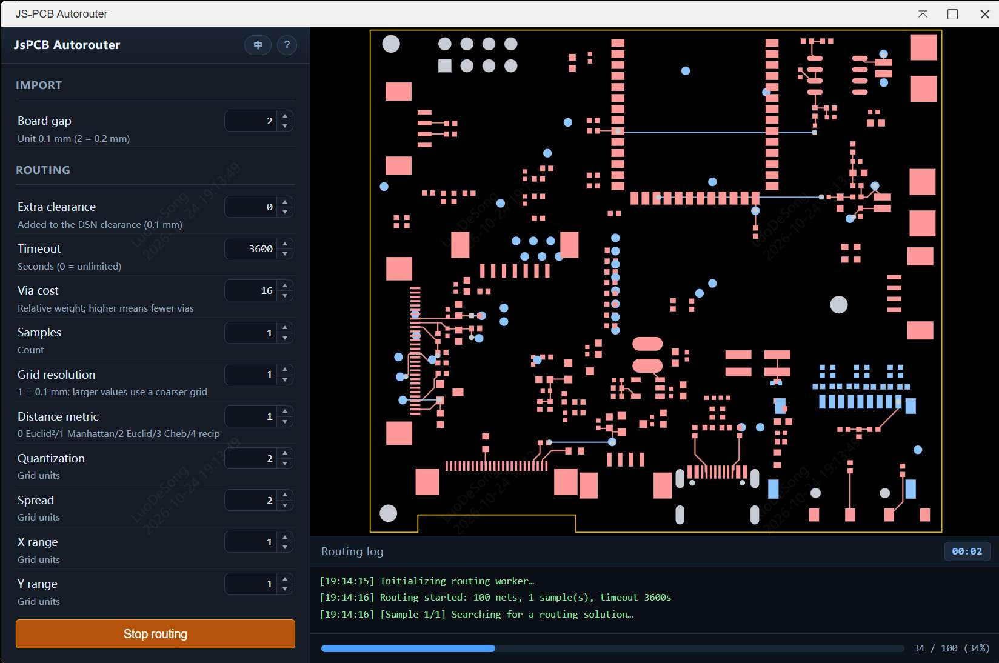

[简体中文](#chinese) · [English](#english)

<a id="chinese"></a>

这是一个为嘉立创EDA专业版（EasyEDA）开发的自动布线扩展插件，集成了开源项目 [JS-PCB](https://github.com/vygr/JS-PCB) 的布线引擎。

## 功能特性

- **一键布线**：自动获取当前 PCB 的 DSN 数据进行布线。
- **参数配置**：支持调整过孔代价、网格分辨率、采样次数等高级布线参数。
- **中英文界面**：打开时跟随嘉立创EDA或浏览器语言，也可通过窗口右上角的语言按钮切换。
- **界面展示**：蓝色主题、参数步进按钮、底部日志及关于弹窗；日志和历史记录随语言切换更新。
- **历史记录**：自动保存布线历史，支持导出历史版本的 SES 文件。
- **布线控制**：显示实时进度，支持停止和重新开始；超时或无法布通的网络会停止重试并保留可用结果。
- **导入方式**：保留手动导入，可选择开启“完成后自动导入”（默认关闭）；部分布通或超时结果需要确认。
- **规则兼容**：修复 DSN 解析、间距、过孔尺寸和焊盘层处理，预览及布线支持多路径板框。
- **共享核心与无头调用**：脚本或 Skill 可直接调用 dry-run 接口；Skill 规则为可选显式输入，普通布线不依赖 Skill。支持固定路径、禁布区、网络筛选和结构化报告。

## 使用方法

1. 安装本扩展。
2. 打开 PCB 文档。
3. 点击顶部菜单：JSPCB - 自动布线
4. 在弹出的窗口中配置布线参数（或保持默认）。
5. 点击 **开始布线**。
6. 等待布线完成，点击 **导入 SES**。


## 无头布线与 Skill 调用

启动后可调用 `external.jspcb.getCapabilities()` 和 `external.jspcb.routeCurrentPcb(options)`，无需先打开布线窗口。省略 `rules` 即按 DSN 规则布线；固定铜和禁布区也不依赖 Skill。首版仅支持 dry-run，未实现的必选约束会明确拒绝，无头导入保持禁用。

接口、坐标单位、能力边界、报告及普通/Skill 调用示例见 [无头 API 文档](docs/headless-api.md)。原有 UI 的历史记录、手动获取/导入/导出和默认关闭的自动导入保持可用。

## 已知局限性与贡献说明

由于 JS-PCB 引擎本身的算法特性限制，**当前的自动布线效果可能较为一般**，特别是对于元件密度较高或规则复杂的 PCB，可能会出现：

- 布通率较低，无法完成所有网络的连接。
- 走线路径不够优化，存在绕线或冗余过孔。
- 网格布线难以完整表达所有复杂设计规则，导入后仍需检查连接与 DRC。
- 超时按每次采样计算，默认 3600 秒，0 表示不限制。

本项目的主要目的是**提供一个将自动布线器集成到 EasyEDA 的技术框架与参考实现**。

我们非常欢迎社区开发者参与进来，基于此框架：

- 优化现有的布线参数配置逻辑。
- 改进底层布线算法。
- 引入或移植其他更强大的开源布线引擎。

希望能通过社区的力量，共同打造一个好用的开源自动布线扩展！

## 贡献来源

本次多语言与界面展示改进部分提取并改编自 [PR #1](https://github.com/XHTimmo/js-pcb/pull/1)，感谢原贡献者 [@easyeda2021](https://github.com/easyeda2021)。保留历史记录与手动导入/导出流程；详细来源及第三方版权声明见 [NOTICE.md](NOTICE.md)，本次 PR 描述草稿见 [docs/pr-1-ui-backport.md](docs/pr-1-ui-backport.md)。

后续通过 [PR #3](https://github.com/XHTimmo/js-pcb/pull/3) 整合 [@easyeda2021](https://github.com/easyeda2021) 的 DSN、布线、焊盘层和过孔修复，同时保留主线的历史记录、手动操作、双语界面与署名。完整来源见 [NOTICE.md](NOTICE.md)。

## 开发验证

```bash
npm ci
npm run typecheck
npm test
node iframe/jspcb/test_runner.js
npm run build
```

`npm test` 统一运行 UI、路由和无头测试；也可分别使用 `test:ui`、`test:routing`、`test:headless`。它们验证语言加载与界面兼容逻辑、实际布线引擎和 DSN→SES 转换，以及无 Skill 调用、固定铜与约束、目标选择和文件输出。`npm run test:watch` 监听变更并重跑测试，`npm run test:coverage` 输出 Node 原生覆盖率报告。命令行测试默认读取 `tests/fixtures/` 下的样例，也支持传入 DSN 路径；构建成功不代表已完成真实 PCB 的布线或 DRC 验证。

## 第三方开源组件说明

本项目在自动布线功能中移植并使用了以下第三方开源项目代码：

- **JS-PCB** (https://github.com/vygr/JS-PCB)
    - 许可证：GNU General Public License v2.0 (GPL-2.0)
    - 原始引擎移植代码位置：`src/core/engine/`（`router.js`、`mymath.js`、`layer.js` 等）；`iframe/jspcb/worker.js` 负责 Worker 消息适配。
    - 修改说明：
        - `iframe/jspcb/index.html`: 修改了 UI 布局和样式以适配 EDA 扩展风格。
        - `iframe/jspcb/main.js`: 增加了与 JLCEDA API 通信的胶水代码（DSN 获取与 SES 导入）。
        - 修复了在 IFrame 环境下 Worker 加载的跨域/安全问题。

**注意**：本扩展包遵循 GPL-2.0 协议分发，许可证全文见 [LICENSE](LICENSE)。SDK 模板原有的 Apache-2.0 许可证与 JLCEDA 版权声明保留于 [LICENSES/Apache-2.0.txt](LICENSES/Apache-2.0.txt)。如果您分发本扩展包或其衍生作品，请确保遵守相应许可证条款。

---

<a id="english"></a>

# JS-PCB Autorouter for EasyEDA

An automatic PCB routing extension for **EasyEDA (嘉立创EDA专业版)**, powered by the open-source [JS-PCB](https://github.com/vygr/JS-PCB) engine.



## Features

- **Automatic DSN loading**: fetches the current PCB's DSN when the dialog opens and previews its board outline and pads. The DSN button also lets you load the board again.
- **Live preview**: updates pads and traces during routing, with colors for different copper layers.
- **Board outlines**: displays multiple DSN boundary paths, including cut-outs, and uses their edges as routing constraints.
- **Start and stop**: stop the active routing task and start another run.
- **Routing controls**: configure timeout, samples, grid resolution, via cost, distance metric and clearance.
- **Progress and logs**: shows the routed-net count and timestamped logs below the preview.
- **Manual and optional automatic import**: import or export SES using the button. Automatic import is **off by default**; when enabled, fully routed results can be imported automatically. Partial or timed-out results require confirmation.
- **Routing history**: keeps the latest 10 results and their parameters, with SES downloads.
- **Chinese and English**: follows the EDA or browser language initially, with a language switch beside the help button. Existing logs and history labels update when the language changes.
- **Shared core and headless API**: scripts and Skills can call the router directly for dry-runs, with explicit optional constraints, protected copper, keepouts, net selection and structured reports. No Skill installation is required.

## Requirements

- EasyEDA with extension support, matching `engines.eda: ^3.2.0`.
- An open PCB for the UI workflow, or an open project and explicit PCB/board target for headless calls.
- Node.js 20.5 or newer to build the extension.

## Build and Installation

```bash
npm ci
npm run build
```

Install the generated `.eext` package from `build/dist/` using **Extensions → Install from file** in EasyEDA, then open a PCB document.

## Usage

1. Open a PCB document in EasyEDA.
2. Choose **JsPCB Autorouter** in the PCB menu.
3. Wait for the DSN to load and the board preview to appear. Use the DSN button to fetch it again if needed.
4. Adjust the routing parameters.
5. Click **Start routing**. The button changes to **Stop routing** while the task is running.
6. After routing finishes, click **Import SES** to apply the result. If you enable automatic import, fully routed results are imported automatically; partial or timed-out results still ask for confirmation.
7. Download previous SES results from **History** when needed.

In a browser environment, the interface accepts a DSN file and downloads the generated SES instead of importing it into EasyEDA.

## Headless Routing and Skill Integration

Startup registers `external.jspcb.getCapabilities()` and `external.jspcb.routeCurrentPcb(options)` without opening an IFrame. Omitting `rules` uses DSN rules; Skill constraints are explicit optional inputs. Protected routes and keepouts can also be used by ordinary callers. This release supports dry-run only and rejects unsupported mandatory constraints and headless import.

See the [headless API documentation](docs/headless-api.md#english) for examples, coordinates, reports and capability limits. Existing history, manual DSN/SES workflows and opt-in UI automatic import remain available.

## Parameters

| Parameter       | Unit / range                       | Description                                                                                        |
| --------------- | ---------------------------------- | -------------------------------------------------------------------------------------------------- |
| Timeout         | Seconds, 0–10000, default **3600** | Maximum time per sample. `0` means no limit. On timeout, the best result found so far is retained. |
| Board gap       | 0.1 mm, 1–5, default 2             | Margin around the board in the routing grid; this is separate from electrical clearance.           |
| Extra clearance | 0.1 mm, 0–20, default 0            | Additional margin applied on top of the DSN clearance.                                             |
| Via cost        | Relative weight, 0–256, default 16 | Higher values discourage vias.                                                                     |
| Samples         | Count, 1–32, default 1             | Number of routing attempts; the best result is selected.                                           |
| Grid resolution | 1–4, default 1                     | Resolution multiplier. Higher values produce a finer grid.                                         |
| Distance metric | 0–4, default 1                     | 0 squared Euclidean, 1 Manhattan, 2 Euclidean, 3 Chebyshev, 4 reciprocal.                          |
| Quantization    | Grid units, 0–64, default 2        | Coordinate quantization used by the routing heuristic.                                             |
| Spread          | Grid units, 0–5, default 2         | Flood-fill search range.                                                                           |
| X / Y range     | Grid units, 0–5, default 1         | Layer-specific horizontal and vertical search ranges.                                              |

## Clearance and Board Constraints

Electrical clearance comes from the DSN: each net uses its class rules, with the structure's rules used as defaults. Padstacks inherit the default clearance. **Extra clearance** adds a global margin on top of those values.

The board boundary is added as an obstacle on each copper layer. The router uses each pad's actual copper layers and layer-specific geometry for connectivity and collision checks. Via definitions are retained from the DSN, and each SES via padstack is declared once.

The **Board gap** parameter controls the routing-grid margin. It does not replace the DSN electrical clearance rules.

## Known Limitations and Contributions

JS-PCB is a relatively simple routing engine. Dense boards or complex rules may lead to incomplete routing, detours or unnecessary vias. Nets that fail after repeated attempts are skipped so that other nets can finish, and timeout applies separately to each sample.

Rules and keepout regions that are not represented by supported DSN data may not be enforced. Imported results still need connectivity checks and DRC in EasyEDA. The included regression fixtures and browser checks do not replace verification in the actual EDA client.

This project provides a framework and reference implementation for integrating an autorouter into EasyEDA. Contributions to routing parameters, algorithms and alternative routing engines are welcome.

## Contribution Sources

The bilingual interface and presentation improvements were partially adapted from [PR #1](https://github.com/XHTimmo/js-pcb/pull/1) by [@easyeda2021](https://github.com/easyeda2021). These changes were integrated through [PR #2](https://github.com/XHTimmo/js-pcb/pull/2), preserving routing history and manual SES import/export.

[PR #3](https://github.com/XHTimmo/js-pcb/pull/3) integrated further DSN parsing, routing, pad-layer and via fixes from the same contributor. The integration preserves the bilingual interface, attribution, history and manual controls, and makes automatic import optional. See [NOTICE.md](NOTICE.md) for source commits and third-party attribution.

## Development and Validation

```bash
npm ci
npm run typecheck
npm test
node iframe/jspcb/test_runner.js
npm run build
```

- `npm test` runs all UI, routing and headless tests. Each group can also be run separately.
- `test:ui` checks language loading, task state, stale-worker handling and import policy.
- `test:routing` checks the actual routing engine and DSN-to-SES conversion.
- `test:headless` checks ordinary calls without Skill, fixed copper, constraints, target selection and artifact output.
- `test:watch` reruns tests on changes; `test:coverage` prints Node's native coverage report.
- The CLI runner uses the bundled DSN files in `tests/fixtures/` by default and also accepts explicit DSN paths.

A successful build does not establish that a real PCB passes routing or DRC validation. See [CHANGELOG.md](CHANGELOG.md) for changes.

## License and Third-Party Components

The extension is distributed under the **GNU General Public License v2.0 (GPL-2.0)**. See [LICENSE](LICENSE) for the complete text.

- **JS-PCB** ([vygr/JS-PCB](https://github.com/vygr/JS-PCB)): GPL-2.0. The ported engine is in `src/core/engine/`, including `router.js`, `mymath.js` and `layer.js`. `iframe/jspcb/worker.js` now adapts Worker messages to the shared solver.
- `iframe/jspcb/main.js` provides DSN fetching, SES import and UI integration with EasyEDA.
- `src/core/engine/dsn-normalizer.js` normalizes DSN coordinates, units and layer names.
- The iframe interface and Worker-loading integration have been adapted for the extension environment.

The original SDK template's Apache-2.0 license and JLCEDA copyright notice are retained in [LICENSES/Apache-2.0.txt](LICENSES/Apache-2.0.txt). Existing third-party notices and contributor attribution remain applicable; see [NOTICE.md](NOTICE.md).
